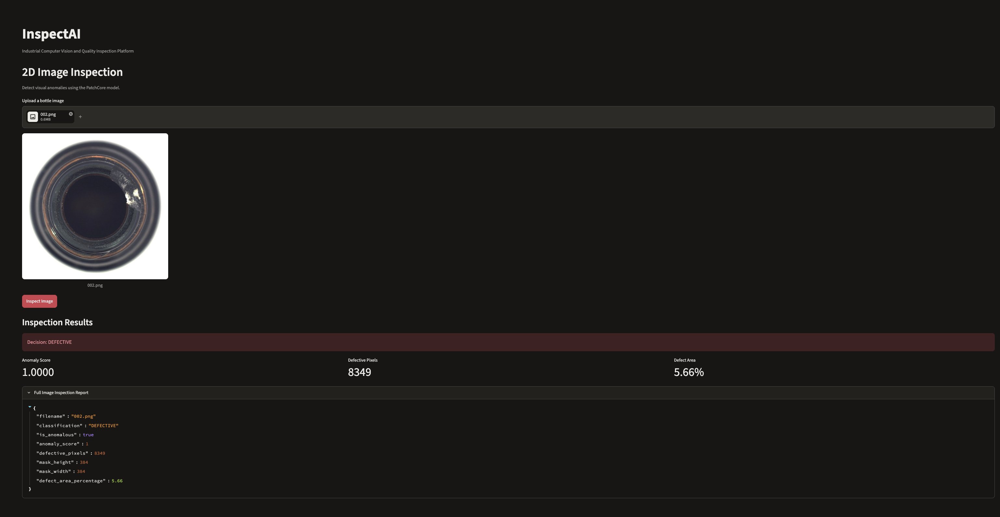
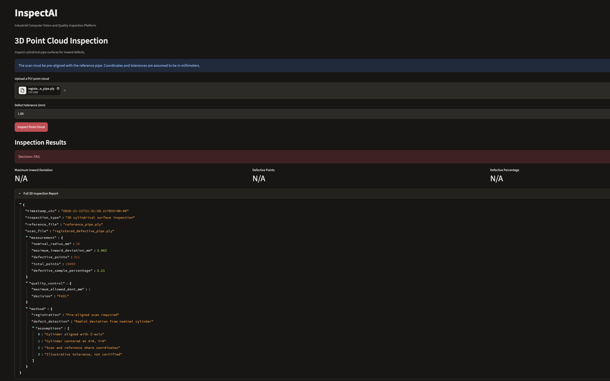
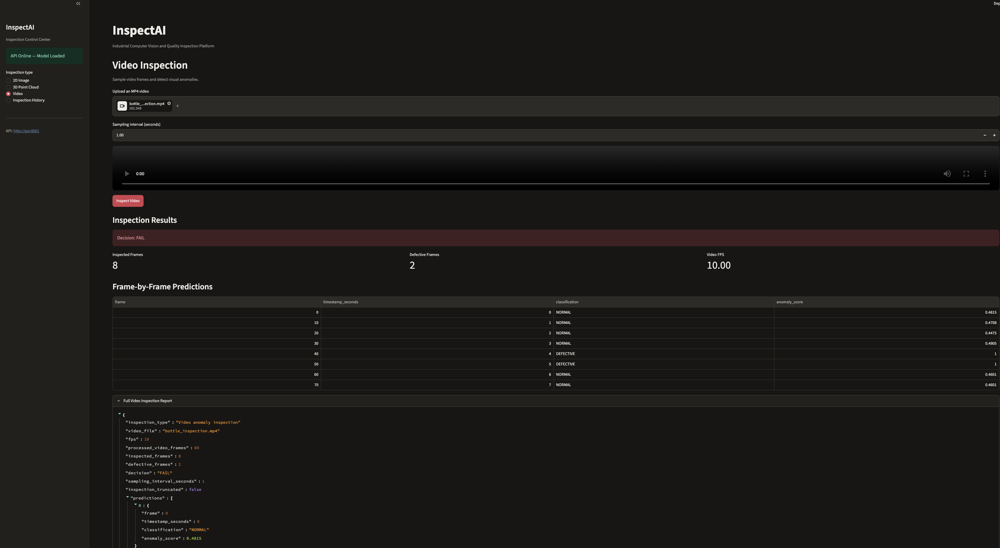
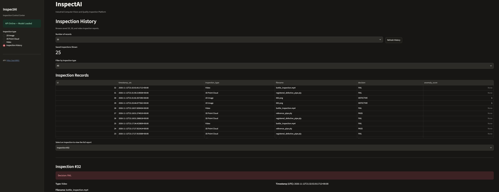

# InspectAI

### Industrial Visual Inspection Platform | Computer Vision + Data Engineering + MLOps

InspectAI is an end-to-end industrial visual inspection platform that combines **2D anomaly detection, 3D point-cloud inspection, video analysis, and data engineering** in a unified application.

The project demonstrates a practical machine learning workflow, from dataset ingestion and validation to model training, inference APIs, experiment tracking, and Docker deployment.

## Dashboard Screenshots

The Streamlit dashboard provides four inspection workflows.

### 1. 2D Image Anomaly Detection



PatchCore detects anomalies in industrial bottle images and returns a classification, anomaly score, and defect-area measurements.

### 2. 3D Point-Cloud Inspection



Open3D-based inspection measures surface deviations in cylindrical components and compares them against a configurable tolerance.

### 3. Video Anomaly Detection



OpenCV samples video frames and uses the trained PatchCore model to identify anomalous frames.

### 4. Inspection History



SQLite stores inspection reports, which can be reviewed through the dashboard.

## Key Features

- **2D Image Inspection:** Detect anomalous regions using PatchCore and Anomalib.
- **3D Point-Cloud Inspection:** Measure surface deviations using Open3D.
- **Video Inspection:** Sample frames with OpenCV and identify anomalies.
- **Data Engineering:** Validate images, calculate SHA256 checksums, detect duplicates, and version datasets.
- **MLOps:** Track model experiments and metrics with MLflow.
- **REST API:** Serve inspection endpoints using FastAPI.
- **Interactive Dashboard:** Inspect images, point clouds, videos, and historical results using Streamlit.
- **Persistence:** Store inspection reports in SQLite.
- **Containerization:** Run FastAPI and Streamlit with Docker Compose.
- **Automated Testing:** Validate application components with Pytest.

## System Architecture


## Technology Stack

| Category | Technologies |
|---|---|
| Language | Python 3.11 |
| Machine Learning | PyTorch, Anomalib, PatchCore |
| Computer Vision | OpenCV |
| 3D Processing | Open3D, NumPy |
| Data Engineering | Pandas, SHA256, CSV manifests |
| Experiment Tracking | MLflow |
| Backend | FastAPI, Uvicorn |
| Frontend | Streamlit |
| Database | SQLite |
| Deployment | Docker, Docker Compose |
| Testing | Pytest |
| Dependency Management | uv |

## 1. Data Engineering Pipeline

The ingestion pipeline performs:

1. Image discovery
2. File validation
3. Image metadata extraction
4. SHA256 checksum calculation
5. Duplicate detection
6. CSV manifest generation
7. Dataset fingerprint creation

### Dataset

The 2D experiments use the MVTec AD bottle category.

| Metric | Value |
|---|---:|
| Files discovered | 355 |
| Valid files | 355 |
| Invalid files | 0 |
| Duplicate files | 0 |

The count includes training images, test images, and ground-truth masks.

The dataset fingerprint is generated from manifest entries and can be associated with experiment records.

**Lineage limitation:** Existing MLflow runs were associated with the fingerprint retrospectively. Exact training-data lineage has not been independently verified.

## 2. PatchCore Anomaly Detection

InspectAI uses PatchCore through Anomalib for unsupervised industrial image anomaly detection.

Two model resolutions were evaluated.

### Model Comparison

| Metric | PatchCore 256 | PatchCore 384 |
|---|---:|---:|
| Image AUROC | 1.0000 | 1.0000 |
| Image F1 | 1.0000 | 1.0000 |
| Pixel AUROC | 0.9753 | 0.9855 |
| Pixel F1 | 0.6463 | 0.7504 |

The 384 × 384 configuration achieved stronger pixel-level results and was selected for deployment.

**Evaluation limitation:** The reported metrics informed model selection and do not represent an independent, untouched final test evaluation.

### Example Defective Image

```json
{
  "filename": "002.png",
  "classification": "DEFECTIVE",
  "is_anomalous": true,
  "anomaly_score": 1.0,
  "defective_pixels": 8349,
  "mask_height": 384,
  "mask_width": 384,
  "defect_area_percentage": 5.66
}
```

### Example Normal Image

```json
{
  "filename": "000.png",
  "classification": "NORMAL",
  "is_anomalous": false,
  "anomaly_score": 0.368559,
  "defective_pixels": 0,
  "mask_height": 384,
  "mask_width": 384,
  "defect_area_percentage": 0.0
}
```

These are functional inference examples, not independent accuracy estimates.

## 3. 3D Point-Cloud Inspection

The 3D pipeline uses Open3D to inspect synthetic cylindrical components.

The inspection measures inward radial deviations relative to a nominal cylindrical reference.

### Example Results

| Measurement | Result |
|---|---:|
| Nominal radius | 20.0 mm |
| Maximum inward deviation | 3.962 mm |
| Allowed tolerance | 1.0 mm |
| Defective points | 321 |
| Total points | 10,000 |
| Defective sample percentage | 3.21% |
| Quality-control decision | FAIL |

### Assumptions

- Point-cloud coordinates use millimeters.
- The cylinder is centered at the origin.
- The cylinder axis aligns with the Z-axis.
- Scans are pre-aligned with the reference.
- Tolerances are illustrative, not industrially certified.

## 4. Video Anomaly Detection

InspectAI uses OpenCV to sample frames from an uploaded video and applies PatchCore to each sampled frame.

### Example Results

| Metric | Result |
|---|---:|
| Video frames | 80 |
| FPS | 10 |
| Duration | 8 seconds |
| Sampling interval | 1 second |
| Inspected frames | 8 |
| Defective frames | 2 |
| Overall decision | FAIL |

Defective frames were identified at **4 and 5 seconds**.

Sampling reduces inference workload but may miss short defects between sampled frames.

## 5. FastAPI Endpoints

| Method | Endpoint | Description |
|---|---|---|
| GET | `/health` | Check API and model status |
| POST | `/inspect` | Inspect a 2D image |
| POST | `/inspect/3d` | Inspect a PLY point cloud |
| POST | `/inspect/video` | Inspect a video |
| GET | `/inspections` | List inspection history |
| GET | `/inspections/{inspection_id}` | Retrieve a saved report |

Interactive API documentation:

http://localhost:8001/docs

### Example: 2D Inspection

```bash
curl -X POST http://127.0.0.1:8001/inspect \
  -F "file=@data/raw/mvtec/bottle/test/broken_small/002.png"
```

### Example: 3D Inspection

```bash
curl -X POST http://127.0.0.1:8001/inspect/3d \
  -F "file=@data/processed/pointclouds/registered_defective_pipe.ply" \
  -F "tolerance_mm=1.0"
```

### Example: Video Inspection

```bash
curl -X POST http://127.0.0.1:8001/inspect/video \
  -F "file=@data/processed/videos/bottle_inspection.mp4" \
  -F "sample_interval_seconds=1.0"
```

## 6. Running Locally

### Requirements

- Python 3.11
- uv package manager
- Project dependencies
- Trained PatchCore checkpoint
- Reference point cloud for 3D inspection

Clone the repository:

```bash
git clone https://github.com/Priya0696/InspectAI.git
cd InspectAI
```

Install dependencies:

```bash
uv sync --locked
```

Start FastAPI:

```bash
PYTHONPATH=src uv run uvicorn inspectai.api.main:app \
  --host 127.0.0.1 \
  --port 8001
```

In another terminal, start Streamlit:

```bash
PYTHONPATH=src uv run streamlit run dashboard/app.py \
  --server.port 8501
```

Open the dashboard:

http://localhost:8501

## 7. Docker Deployment

InspectAI includes a Dockerfile and Docker Compose configuration.

The Docker setup has been validated locally on an Apple Silicon ARM64 machine.

### Build

```bash
docker compose build
```

### Start

```bash
docker compose up -d
```

### Verify

```bash
docker compose ps
curl http://127.0.0.1:8001/health
```

A successful health check returns:

```json
{
  "status": "healthy",
  "model_loaded": true
}
```

### Access Services

| Service | URL |
|---|---|
| Streamlit Dashboard | http://localhost:8501 |
| FastAPI Documentation | http://localhost:8001/docs |
| FastAPI Health | http://localhost:8001/health |

### Stop

```bash
docker compose down
```

### Required Local Artifacts

The Docker configuration expects the following files:

```text
reports/patchcore_384/Patchcore/MVTecAD/bottle/v0/weights/lightning/model.ckpt

data/processed/pointclouds/reference_pipe.ply
```

The dataset, trained model checkpoints, generated reports, and local databases are excluded from GitHub.

A fresh clone requires preparing these artifacts before running the full inference service. Docker does not automatically download or train the model.

## 8. Automated Testing

Run:

```bash
PYTHONPATH=src uv run pytest -q
```

Latest verified result:

```text
49 passed, 3 warnings
```

The three warnings originate from third-party library deprecations.

### Docker Validation

The following workflows were tested successfully:

- FastAPI startup and model loading
- Normal image classification
- Defective image classification
- Synthetic 3D defect detection
- Video anomaly detection
- SQLite inspection history
- Streamlit dashboard functionality

## 9. MLflow Experiment Tracking

MLflow tracks the PatchCore configurations, evaluation metrics, and associated dataset-version metadata.

Start the MLflow UI:

```bash
uv run mlflow ui \
  --backend-store-uri sqlite:///mlflow.db \
  --host 127.0.0.1 \
  --port 5000
```

Open:

http://127.0.0.1:5000

## 10. Project Structure

```text
InspectAI/
├── dashboard/
│   └── app.py
├── docs/
│   └── screenshots/
│       ├── dashboard-2d.png
│       ├── dashboard-3d.png
│       ├── dashboard-video.png
│       └── dashboard-history.png
├── scripts/
│   ├── data/
│   ├── mlops/
│   ├── three_d/
│   └── video/
├── src/
│   └── inspectai/
│       ├── api/
│       ├── inference/
│       ├── ingestion/
│       ├── inspection/
│       └── storage/
├── tests/
├── Dockerfile
├── compose.yaml
├── pyproject.toml
├── uv.lock
└── README.md
```

The screenshot files are added separately and must exist at the paths shown for the README images to render.

## 11. Limitations and Future Improvements

InspectAI is a portfolio and research demonstration, not a certified industrial inspection product.

### Current Limitations

- No independent final evaluation after model selection
- Synthetic 3D point-cloud data
- Pre-aligned 3D scans required
- Illustrative defect tolerances
- Sampled rather than continuous video inference
- No authentication or authorization for public deployment
- Trained checkpoints are not distributed in Git
- Historical MLflow dataset lineage is not independently verified

### Potential Improvements

- Evaluate on additional industrial datasets
- Add independent final model validation
- Improve 3D registration and geometric defect detection
- Add authenticated access and monitoring
- Automate model artifact management
- Add CI/CD and automated Docker validation
- Provide a reproducible demo model or documented training workflow

## 12. Dataset Attribution

The 2D experiments use the **MVTec Anomaly Detection (MVTec AD)** dataset.

Official dataset:

https://www.mvtec.com/company/research/datasets/mvtec-ad

Dataset licensing and usage conditions should be reviewed before redistribution.

## License

No project license has been selected. Third-party dependencies and datasets retain their respective licenses.
