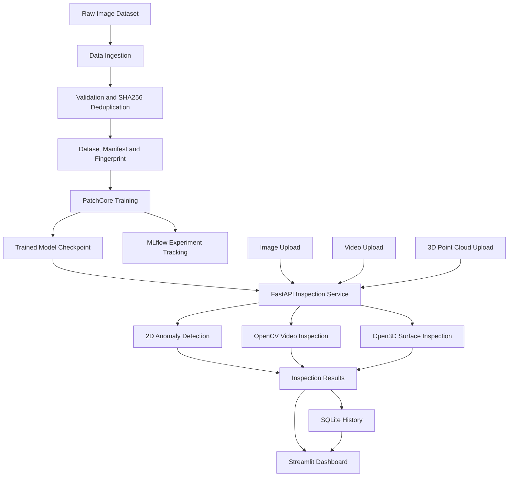

# InspectAI

### Industrial Visual Inspection Platform | Computer Vision + Data Engineering + MLOps

InspectAI is an end-to-end industrial visual inspection project combining image anomaly detection, 3D point-cloud analysis, and video inspection in a unified platform.

The project demonstrates the integration of data engineering, machine learning, backend APIs, experiment tracking, and containerized deployment.

## Features

- **2D Image Inspection:** Detect anomalous regions using PatchCore and Anomalib.
- **3D Point-Cloud Inspection:** Measure surface deviations on cylindrical components using Open3D.
- **Video Inspection:** Sample video frames with OpenCV and classify anomalies.
- **Data Engineering:** Validate images, calculate SHA256 checksums, detect duplicates, and version datasets.
- **MLOps:** Track PatchCore experiments using MLflow.
- **REST API:** Serve inspection endpoints using FastAPI.
- **Dashboard:** Inspect images, point clouds, videos, and historical results with Streamlit.
- **Persistence:** Store inspection reports in SQLite.
- **Docker:** Run the backend and dashboard in containers.

## System Architecture



## Technology Stack

| Category | Technologies |
|---|---|
| Programming | Python 3.11 |
| Machine Learning | PyTorch, Anomalib, PatchCore |
| Computer Vision | OpenCV |
| 3D Processing | Open3D, NumPy |
| Data Engineering | Pandas, SHA256, CSV manifests |
| Experiment Tracking | MLflow |
| Backend | FastAPI, Uvicorn |
| Dashboard | Streamlit |
| Database | SQLite |
| Deployment | Docker, Docker Compose |
| Testing | Pytest |
| Dependency Management | uv |

## 1. Data Engineering Pipeline

The ingestion pipeline discovers images, validates supported image files, extracts metadata, calculates SHA256 checksums, and identifies duplicate content.

Generated artifacts include:

- Image manifest
- File validation results
- SHA256 checksums
- Duplicate indicators
- Dataset version fingerprint

### Dataset

The 2D inspection experiments use the MVTec AD bottle category.

The ingestion exercise processed:

| Metric | Value |
|---|---:|
| Files discovered | 355 |
| Valid files | 355 |
| Invalid files | 0 |
| Duplicate files | 0 |

The count includes training images, test images, and ground-truth masks.

Dataset versioning creates a reproducible fingerprint from manifest entries. This fingerprint can be associated with experiment records.

**Dataset lineage limitation:** Existing MLflow training runs were associated with the fingerprint retrospectively. Their exact training-data lineage has not been independently verified.

## 2. 2D Anomaly Detection

InspectAI uses PatchCore through Anomalib to detect anomalies in industrial images.

Two input resolutions were evaluated:

| Metric | 256 × 256 | 384 × 384 |
|---|---:|---:|
| Image AUROC | 1.0000 | 1.0000 |
| Image F1 | 1.0000 | 1.0000 |
| Pixel AUROC | 0.9753 | 0.9855 |
| Pixel F1 | 0.6463 | 0.7504 |

The 384 × 384 model was selected based on the reported evaluation results.

**Evaluation limitation:** These metrics were used during model selection. They should not be presented as performance on an independent, untouched final test set.

### Docker API validation

A known defective bottle produced:

- Classification: `DEFECTIVE`
- Anomaly score: `1.0`
- Defective pixels: `8,349`
- Defect area: `5.66%`

A known normal training image produced:

- Classification: `NORMAL`
- Anomaly score: approximately `0.3686`
- Defective pixels: `0`

These examples validate the inference workflow but do not constitute an independent accuracy benchmark.

## 3. 3D Point-Cloud Inspection

The 3D pipeline uses Open3D to inspect synthetic cylindrical components.

The inspection compares a pre-aligned scan against a nominal cylindrical reference and measures inward radial deviation.

### Example results

| Measurement | Value |
|---|---:|
| Nominal radius | 20.0 mm |
| Maximum inward deviation | 3.962 mm |
| Allowed tolerance | 1.0 mm |
| Defective points | 321 / 10,000 |
| Defective sample percentage | 3.21% |
| Decision | FAIL |

### Assumptions

- Point clouds use millimeter units.
- The cylinder is centered at the origin.
- The cylinder axis aligns with the Z-axis.
- Input scans are pre-aligned with the reference.
- The tolerance is illustrative, not certified for industrial use.

## 4. Video Inspection

InspectAI uses OpenCV to sample frames from an uploaded video and applies the image anomaly detector to each sampled frame.

### Example validation

| Metric | Value |
|---|---:|
| Video frames | 80 |
| Frame rate | 10 FPS |
| Duration | 8 seconds |
| Sampling interval | 1 second |
| Inspected frames | 8 |
| Defective frames | 2 |
| Overall decision | FAIL |

Anomalies were detected at approximately 4 and 5 seconds.

Frame sampling reduces inference work but can miss defects appearing between sampled frames.

## 5. API Endpoints

| Method | Endpoint | Description |
|---|---|---|
| GET | `/health` | Check API health and model loading |
| POST | `/inspect` | Inspect a 2D image |
| POST | `/inspect/3d` | Inspect a 3D PLY point cloud |
| POST | `/inspect/video` | Inspect a video |
| GET | `/inspections` | List inspection history |
| GET | `/inspections/{inspection_id}` | Retrieve an inspection report |

Interactive API documentation:

http://localhost:8001/docs

### Example: Inspect an image

```bash
curl -X POST http://127.0.0.1:8001/inspect \
  -F "file=@data/raw/mvtec/bottle/test/broken_small/002.png"
```

### Example: Inspect a point cloud

```bash
curl -X POST http://127.0.0.1:8001/inspect/3d \
  -F "file=@data/processed/pointclouds/registered_defective_pipe.ply" \
  -F "tolerance_mm=1.0"
```

### Example: Inspect a video

```bash
curl -X POST http://127.0.0.1:8001/inspect/video \
  -F "file=@data/processed/videos/bottle_inspection.mp4" \
  -F "sample_interval_seconds=1.0"
```

## 6. Running Locally

### Requirements

- Python 3.11
- uv
- Project dependencies
- A compatible PatchCore checkpoint
- A reference point cloud for 3D inspection

Install dependencies:

```bash
uv sync --locked
```

Run the API:

```bash
PYTHONPATH=src uv run uvicorn inspectai.api.main:app \
  --host 127.0.0.1 --port 8001
```

In another terminal, start Streamlit:

```bash
PYTHONPATH=src uv run streamlit run dashboard/app.py \
  --server.port 8501
```

Open:

http://localhost:8501

## 7. Running with Docker

The project includes a Dockerfile and Docker Compose configuration.

Docker has been validated locally on an Apple Silicon ARM64 machine.

Build the image:

```bash
docker compose build
```

Start the services:

```bash
docker compose up -d
```

Check status:

```bash
docker compose ps
```

Verify API health:

```bash
curl http://127.0.0.1:8001/health
```

Open the dashboard:

http://localhost:8501

Stop services:

```bash
docker compose down
```

### Required local artifacts

The Docker Compose setup expects these files to exist on the host:

```text
reports/patchcore_384/Patchcore/MVTecAD/bottle/v0/weights/lightning/model.ckpt

data/processed/pointclouds/reference_pipe.ply
```

The model checkpoint, raw dataset, generated reports, and local databases are intentionally excluded from Git.

A fresh clone therefore requires preparing the dataset and model artifacts before starting the complete inference service. The repository is not a one-command, artifact-free installation.

## 8. Testing

Run the automated test suite:

```bash
PYTHONPATH=src uv run pytest -q
```

Latest verified local result:

```text
49 passed, 3 warnings
```

Docker integration checks have also verified:

- FastAPI startup and PatchCore loading
- Normal and defective image classification
- Synthetic 3D surface inspection
- Video anomaly detection
- SQLite inspection history
- Streamlit dashboard functionality

## 9. Experiment Tracking

MLflow is used to compare PatchCore configurations.

The tracked experiments include 256 × 256 and 384 × 384 model configurations, associated evaluation metrics, and dataset-version metadata.

Start the local MLflow interface:

```bash
uv run mlflow ui \
  --backend-store-uri sqlite:///mlflow.db \
  --host 127.0.0.1 \
  --port 5000
```

Open http://127.0.0.1:5000.

## 10. Limitations and Future Work

InspectAI is a portfolio and research demonstration, not a certified industrial inspection system.

Current limitations include:

- No independent final test set after model selection
- Synthetic 3D defect data
- Pre-aligned point-cloud requirement
- Illustrative geometric tolerances
- Sampled rather than continuous video inference
- Local-only deployment without authentication
- Model checkpoints not included in the Git repository
- Historical experiment lineage not independently verified

Potential improvements include real industrial 3D datasets, stronger data lineage, independent model validation, access control, and production monitoring.

## Project Status

- Data ingestion and validation: Complete
- Dataset fingerprinting: Complete
- PatchCore inference: Complete
- 3D inspection: Complete
- Video inspection: Complete
- FastAPI backend: Complete
- Streamlit dashboard: Complete
- SQLite history: Complete
- Docker ARM64 validation: Complete
- Automated tests: 49 passing

## Dataset Attribution

2D anomaly detection uses the MVTec Anomaly Detection (MVTec AD) dataset.

Official dataset information:
https://www.mvtec.com/company/research/datasets/mvtec-ad

Review the dataset's license and usage conditions before redistribution.

## License

No project license has been selected yet. Third-party dependencies and datasets retain their respective licenses.
